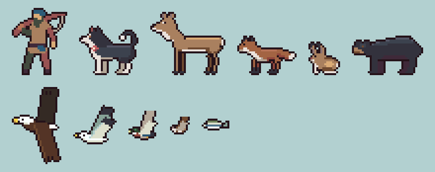

# The creatures

Olive and every animal at the lake are drawn by the game's own scripts in
`tools/characters/`, one file each, all built with one kit (`kit.py`). They
replaced the deer, fox, hare, bear, gulls, sparrows, ducks, eagle and minnows
that came from five different art packs, which each had their own scale,
outline and colours.

## The rules they share

These came out of building Olive, the fish (`tools/fish_art.py`), the
journal and the backpack, and from the research below.

1. **Side-on, facing left, one light from above.** A lighter band along the
   back, shade underneath, and the far legs (or the far wing) a step darker
   than the near ones. The game turns each creature to face the way it goes.
2. **One palette, one outline.** Every colour is from the master palette
   (`tools/palette.json`; the kit refuses anything else), and every creature
   wears the shared outline, `#25131a`, put round it after drawing. They
   are saved exactly as drawn, never recoloured afterwards.
3. **Real animals, one scale.** Sizes come from the real animal measured
   against the angler (34 pixels for 5 ft 9 in: half a pixel to the inch).
   Big animals are near true size; small ones are drawn up to 1.6 times
   larger so they still read, the way games draw pets. So a fox is smaller
   than Olive, a hare comes up to her chest, and the deer and the bear stand
   a little over half the angler's height.
4. **What makes the species, first.** The silhouette and one or two marks
   you'd know it by: the fox's black stockings and white-tipped brush, the
   doe's white throat and big ears, the black bear's straight face, big
   ears and rump higher than its shoulders (not a grizzly's hump), the
   hare's long black-tipped ears and big hind feet, the eagle's white head
   and tail, the drake's green head and white collar.
5. **A body drawing, legs from joints.** The body and head are one pixel
   drawing; the legs are drawn every frame through their joints (shoulder,
   wrist, paw; hip, hock, paw), so a gait can pose them freely. The hare,
   whose whole body changes shape through a hop, is drawn pose by pose.
6. **Real gaits, readable at this size.** Walks are four-beat, three feet
   down at a time (Olive, the doe); the fox trots, diagonal legs together,
   which is also what reads best at small sizes; the bear ambles, the legs
   on one side swinging nearly together; the hare's hind feet land ahead of
   its front feet. The body dips or lifts a pixel as the legs pass under it.
7. **Birds are seen from below.** That's how you see a bird crossing the
   sky: the body in profile, the far wing reaching up behind it, the near
   wing down in front. Gulls and the eagle beat and glide; ducks beat fast
   and never glide; sparrows fly in bounds, a burst of beats then wings
   shut. On the downstroke the body lifts a pixel.
8. **Moving with the feet.** A creature moves only when its walk advances a
   frame, by a step that comes from its gait, so its feet don't slide.

## Who's who

| Creature | Real size → on the grid | Look | Animations |
| --- | --- | --- | --- |
| [Olive](olive.md) | 18 in at the shoulder, drawn 1.6x → 40 x 30 frame | black and white husky / cattle dog, coral bandana | idle, walk, run, leap, swim, shake |
| White-tailed doe (`deer.py`) | 36 in at the shoulder → 18 px | tawny, white throat patch, muzzle band, eye ring, belly and tail edge; big ears; slender legs, dark hooves | walk (four-beat), idle (ear flick, drinks, tail flick) |
| Red fox (`fox.py`) | 15 in, drawn 1.5x → 11 px | rusty, lighter back, white chin to chest, black stockings and ear backs, white-tipped brush | walk (the trot), idle (sniffing the ground, ear flick, tail swish) |
| Snowshoe hare (`hare.py`) | sits 11 in, drawn 1.6x | cinnamon brown, darker back line, buff flanks, white belly, tail and feet, black-tipped ears | hop (moves only in the air), idle (nibbling, nose twitch, sits up alert, ear turns) |
| Black bear (`bear.py`) | 33 in at the shoulder → 16 px | black, sheen on the back, tan muzzle, brown eyes, big ears, no hump | walk (the amble, head low), idle (lifts its nose to scent the air) |
| Ring-billed gull (`gull.py`) | 4 ft wings | white, pale grey wings with black tips, yellow bill with a black ring | fly (beat), glide |
| Song sparrow (`sparrow.py`) | 8 in wings, drawn 2x | streaky brown, pale breast | fly (bounding) |
| Mallard (`mallard.py`) | 3 ft wings | drake: green head, white collar, chestnut breast, grey sides, black stern; hen: mottled brown; both a blue speculum | fly (drake), hen |
| Bald eagle (`eagle.py`) | 6 1/2 ft wings | dark brown, white head and tail, yellow bill and feet, fingered wingtips | fly (slow beats), glide |
| Shiner minnow (`minnow.py`) | 3 in | olive back, silver sides, dark stripe, white belly | swim |

Each script writes its sheet (`assets/art/characters/<name>.png`), its
animation table (`<name>.json`, also in the manifest under
`anchors.creatures`) and previews here (`<name>-sheet.png` and a GIF per
animation). Run one on its own, e.g. `python3 tools/characters/fox.py`, or
the whole art build. `python3 tools/characters/lineup.py` redraws the
lineup above.

## Research

- White-tailed deer: [Virginia DWR](https://www.dgif.virginia.gov/wildlife/information/white-tailed-deer),
  [Pennsylvania Game Commission](https://www.pa.gov/agencies/pgc/wildlife/discover-pa-wildlife/white-tailed-deer.html),
  [Minnesota DNR, deer and elk identification](https://www.dnr.state.mn.us/hunting/deer/deer-elk-id.html)
- Black bear: [NPS, bear identification](https://www.nps.gov/articles/bear-identification.htm),
  [Bear Smart, know the difference](https://bearsmart.com/about-bears/know-the-difference)
- Snowshoe hare: [SUNY ESF](https://www.esf.edu/aec/adks/mammals/snowshoe_hare.htm),
  [Wildwood Tracking](https://wildwoodtracking.com/quiz/quiz054/quiz054A.html)
- Dogs and the gallop: Eadweard Muybridge, *Animal Locomotion* (1887), public domain
- Pixel-art walk cycles: [Walk cycle guide (OpenGameArt)](https://opengameart.org/content/walk-cycle-guide),
  [AGS forums on quadruped walks](https://www.adventuregamestudio.co.uk/forums/index.php?msg=394078),
  [Pixel art walk cycle animation (itch.io)](https://itch.io/blog/526535/pixel-art-walk-cycle-animation)
- Bird flight: [Small birds, 2D Animation: Animate Flying Creatures](https://origin-www.lynda.com/3D-Animation-tutorials/Small-birds/501129/602246-4.html)
  (the wings reverse and fold on the upstroke; the body moves against the wings)
- The CC0 [animated wild animals](https://opengameart.org/content/animated-wild-animals) by ScratchIO,
  studied for a canid's body plan and walk at sprite size (nothing copied)
