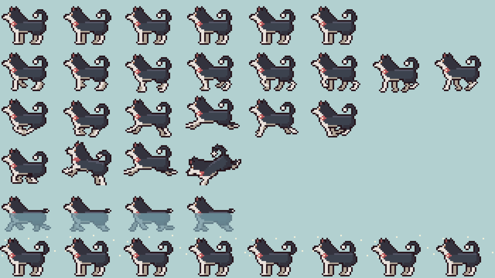
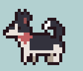
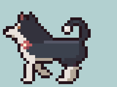
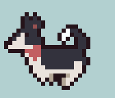
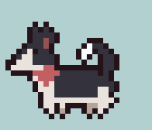
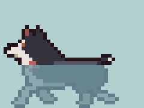

# Olive

Olive is the angler's dog, and a character of her own. She's modelled on a
real dog, a 40 lb husky / Australian cattle dog mix, but drawn as a game
character: side-on, in the game's palette, and always on the move.

| Idle | Walk | Run | Leap | Swim | Shake |
| --- | --- | --- | --- | --- | --- |
|  |  |  |  |  |  |

## What she does

She keeps the angler company on the dock, standing about with her tail
wagging and wandering up and down the boards behind him. Every half a
minute or so she gallops off the end of the walkway, leaps into the lake
with a splash, dog-paddles over to the far bank, scrambles out and shakes
herself dry, then runs off round the shore and comes back along the dock
from the hut. A field note says when she jumps in.

## Her files

Everything that is Olive lives under her name:

| What | Where |
| --- | --- |
| Her drawing and animations (source) | `tools/characters/olive.py` |
| Her sprite sheet and animation table | `assets/art/characters/olive/olive.png`, `olive.json` |
| In the game's art | the `olive` sheet in `assets/art/manifest.json`; animations `olive-idle`, `olive-walk`, `olive-run`, `olive-leap`, `olive-swim`, `olive-shake`; anchors `olive-at` (where her paws stand, where the water comes up to) |
| Her behaviour in the game | `src/characters/olive/Olive.js` |
| This sheet and her previews | `docs/characters/` |

Build her on her own with `python3 tools/characters/olive.py`; the full art
build (`python3 tools/build_art.py`) includes her.

## How she looks

- **Coat:** black, with a sheen along her back.
- **Face:** a white blaze down to a white muzzle, a black nose, warm brown
  eyes, upright ears pink inside.
- **Body:** white throat, chest, belly and legs; black thighs; a plumed tail
  curled over her back with a white tip.
- **Bandana:** coral with cream flowers.

## How she's built

Her proportions follow a real canid. Her body plan and walk were worked out
over the CC0 fox already in the game (`assets/source/scratchio-wild-animals`),
then made stockier for a 40 lb dog: a deeper chest, a tucked belly, thicker
legs, a shorter, broader head. At 40 x 30 pixels she stands a little over
half the angler's height, as pets are drawn in pixel games so they read.

Her body and head are one pixel drawing. Her legs are drawn every frame from
joint positions (shoulder, wrist, paw in front; hip, hock, paw behind), two
pixels thick, the far pair in shade; the leap's tilted frames are turned on
the pixel grid.

| Animation | Frames | Speed | What it does |
| --- | --- | --- | --- |
| `idle` | 6 | 4 fps | standing, tail wagging, a blink |
| `walk` | 8 | 10 fps | a four-beat walk: three paws down at a time, each paw swept back under her then lifted and swung forward, a dip as the weight passes over |
| `run` | 6 | 14 fps | the rotary gallop: gathered, hind feet land, push off, stretched out in the air, front feet land, front push |
| `leap` | 4 | by the jump | a crouch, a spring with her nose up, stretched out over the water, nose down to dive |
| `swim` | 4 | 6 fps | dog-paddling: head and back above water, legs churning below, seen dimmer and bluer through the water, tail floating behind |
| `shake` | 8 | 14 fps | twisting side to side over planted feet, tail flung the other way, drops flying |

In the game she only moves when her walk or gallop advances a frame, by
that frame's step, so her paws don't slide.

## Sources

- [Animated wild animals (ScratchIO, CC0)](https://opengameart.org/content/animated-wild-animals): the fox whose build and walk she was worked out over
- Eadweard Muybridge, *Animal Locomotion* (1887), plates 704 to 707: dogs walking and galloping (public domain)
- [Australian Cattle Dog (Wikipedia)](https://en.wikipedia.org/wiki/Australian_Cattle_Dog),
  [Siberian Husky: UKC standard](https://www.UKCDogs.com/docs/breeds/siberian-husky.pdf)
- [Animating Four-Legged Beasts (Game Developer)](https://www.gamedeveloper.com/art/animating-four-legged-beasts)
