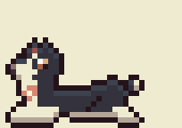
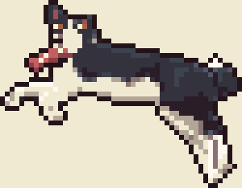
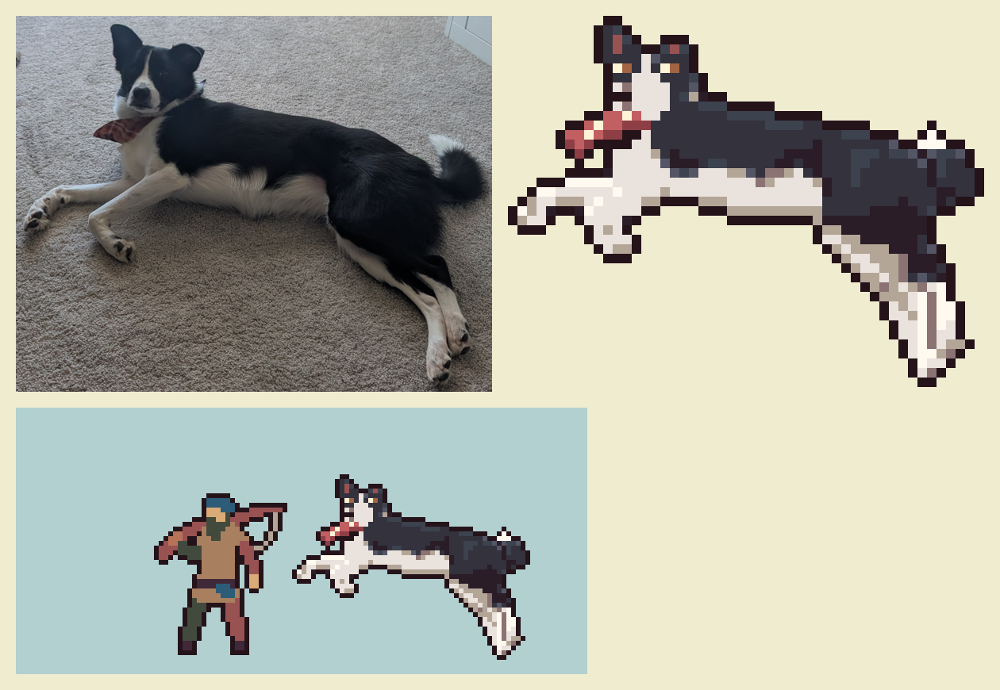

# Olive

Olive is the angler's dog, and a character of her own: a 40 lb husky /
Australian cattle dog mix who keeps him company on the dock.

| Lying (breathing) | Blink | Tail wag | Ear flick |
| --- | --- | --- | --- |
|  |  |  |  |

## Her files

Everything that is Olive lives under her name:

| What | Where |
| --- | --- |
| Her drawing and animations (source) | `tools/characters/olive.py` |
| Her sprite sheet and animation table | `assets/art/characters/olive/olive.png`, `olive.json` |
| In the game's art | the `olive` sheet in `assets/art/manifest.json`, animations `olive-lie`, `olive-blink`, `olive-wag`, `olive-ear` |
| This sheet and her previews | `docs/characters/` |

Build her on her own with `python3 tools/characters/olive.py`; the full art
build (`python3 tools/build_art.py`) includes her.

## How she looks

She's rotoscoped from a photo of her lying on the carpet, so her shape,
pose and markings are her own rather than a drawn guess:

1. Her outline and her white markings (blaze and muzzle, throat and chest,
   front legs and belly, hind legs, the tip of her tail) were traced by hand
   over the photo.
2. The photo was shrunk to sprite size inside those shapes, and its own light
   and shade sampled into the game's palette: four shades of black coat (from
   deep shadow to the sheen along her back) and four of white fur.
3. Her face (eyes, nose, the line of her mouth), her ears and her bandana
   were finished by hand, and the game's shared outline drawn around her.

- **Coat:** black, sheen along her back, shadow under her ribs and thigh.
- **Face:** a narrow white blaze widening to a white muzzle, a black nose
  with a shine, warm brown eyes with catchlights.
- **Ears:** both up, pink inside.
- **Body:** white throat, chest, belly and front legs; black thigh over white
  hind legs; a plumed tail curled over her rump with a white tip.
- **Bandana:** coral with cream flowers, knotted at her throat.

## Her size

50 x 39 pixels lying down, beside the 48-pixel angler frame. The photo was
taken from a little above her, so her stretched hind legs reach down the
frame as they do in the picture.

## How she moves

Each animation is a small change to the one traced drawing, the way a dog
lying down really moves, so she always looks like herself.

| Animation | Frames | Speed | What it does |
| --- | --- | --- | --- |
| `lie` | 4 | 2 fps | a slow breath: the line of her back rises a pixel from shoulder to hip, her tail tip stirring a beat behind |
| `blink` | 3 | 8 fps | a quick blink |
| `wag` | 4 | 8 fps | the white tip of her tail swinging either way |
| `ear` | 3 | 6 fps | her right ear twitching back at a sound |

Standing, walking and trotting will be traced the same way, from a side-on
photo or video of her and Muybridge's public-domain plates of a dog walking
(*Animal Locomotion*, 1887, plate 704) for the footfall timing.

## Sources

- [Australian Cattle Dog (Wikipedia)](https://en.wikipedia.org/wiki/Australian_Cattle_Dog),
  [UKC standard](https://www.UKCDogs.com/docs/breeds/australian-cattle-dog.pdf),
  [The Kennel Club](https://thekennelclub.org.uk/services/public/breed/display.aspx?id=5172)
- [Siberian Husky: UKC standard](https://www.UKCDogs.com/docs/breeds/siberian-husky.pdf),
  [FCI standard](https://WWW.FCI.BE/Nomenclature/Standards/270g05-en.pdf),
  [SHCA head](https://shca.org/head)
- [Australian Cattle Dog x Siberian Husky (Hepper)](https://articles.hepper.com/australian-cattle-siberian-husky/)
- [Animating Four-Legged Beasts (Game Developer)](https://www.gamedeveloper.com/art/animating-four-legged-beasts),
  [A quick guide to animating animals](https://www.gamedeveloper.com/art/a-quick-guide-to-animating-animals),
  [Polycount quadruped walk feedback](https://polycount.com/discussion/190834/feedback)
- [The 12 principles of animation in video games](https://www.gamedeveloper.com/production/the-12-principles-of-animation-in-video-games)
- Dog sprite packs for reference: [OpenGameArt dog sprites](https://opengameart.org/content/dog-sprites),
  [dog 3](https://opengameart.org/content/dog-3), [pixel wolf](https://opengameart.org/content/pixel-wolf),
  [dog animation, 4 dogs](https://nvph-studio.itch.io/dog-animation-4-different-dogs)
