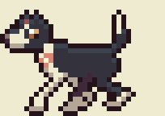
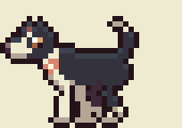
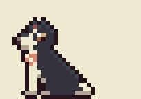

# Olive

Olive is the angler's dog, and a character of her own: a 40 lb husky /
Australian cattle dog mix who keeps him company on the dock.

| Idle | Walk | Trot | Head tilt | Sit | Lie |
| --- | --- | --- | --- | --- | --- |
|  |  |  |  |  |  |

## Her files

Everything that is Olive lives under her name:

| What | Where |
| --- | --- |
| Her rig and drawings (source) | `tools/characters/olive.py` |
| Her sprite sheet and animation table | `assets/art/characters/olive/olive.png`, `olive.json` |
| In the game's art | the `olive` sheet in `assets/art/manifest.json`, animations `olive-idle`, `olive-walk`, `olive-trot`, `olive-tilt`, `olive-sit`, `olive-lie` |
| This sheet and her previews | `docs/characters/` |

Build her on her own with `python3 tools/characters/olive.py`; the full art
build (`python3 tools/build_art.py`) includes her.

## How she looks

Drawn from photos of her, in the game's palette with its shared outline:

- **Coat:** black, with light along her back and her far side in shade.
- **Face:** a narrow white blaze up her forehead widening to a white muzzle;
  a glossy black nose with a shine, rounded at the end.
- **Eyes:** warm amber-brown, at the stop where the white of her muzzle meets
  the black: a white catchlight, a two-tone iris (light catching the top),
  a dark pupil, and a pixel of black fur between the eye and the blaze so
  they don't run together.
- **Ears:** one up (pink inside), one tipped over.
- **Body:** white chest and throat, white front legs, black hind legs with
  white socks, a plumed tail carried up in a curl with a white tip.
- **Bandana:** coral with little cream flowers.
- **Habit:** she tilts her head when she's curious.

## Her proportions

Taken from her parents' breed standards, then drawn a little larger than
life so she reads beside the angler.

- A cattle dog's body is a little longer than she is tall at the shoulder,
  10 to 9, breastbone to buttocks.
- A husky's muzzle (nose to stop) is as long as its skull (stop to the back
  of the head), with a clear stop.
- A husky's leg from elbow to ground is slightly longer than from elbow to
  withers, so her legs are about as long as her chest is deep.
- At 40 lb she's at the small end of the mix (about 18 inches at the
  shoulder). Beside the angler, about 34 pixels tall, a dog her size would
  be about a third of his height; pixel games draw pets a little large so
  they read, so she stands a bit over half his height, about 13 pixels at
  the shoulder.

## How she moves

She's built as a small pixel rig rather than drawn frame by frame. Her head
and body are fixed pixel drawings; her legs are jointed (shoulder, elbow,
wrist, paw in front; hip, stifle, hock, paw behind) and placed by a gait;
her tail is a chain of segments. Every frame still lands on whole pixels.

| Animation | Frames | Speed | What it does |
| --- | --- | --- | --- |
| `idle` | 4 | 4 fps | a slow breath (her back rises a pixel), the tail wagging a frame behind |
| `walk` | 8 | 10 fps | a four-beat walk: hind-left, fore-left, hind-right, fore-right, three paws down at any moment; her hips rise as each hind paw passes under her, the head nods against the body, the tail sways a beat late |
| `trot` | 6 | 12 fps | diagonal pairs together, a longer stride, a moment with all four paws up, the body bobbing on each beat |
| `tilt` | 3 | 6 fps | her curious head tilt: a little dip first (anticipation), then the tilt, held |
| `sit` | 2 | 2 fps | sitting, breathing |
| `lie` | 2 | 1.5 fps | lying as on the carpet, head up, front legs out ahead; a slow breath |

The principles behind it: quadrupeds share one footfall order (Muybridge);
a walk is a four-beat gait with three feet down at a time, a trot moves
diagonal pairs together; the hips rise as a foot passes under the body;
secondary parts (tail, ears) follow through a frame behind the body;
anticipation before a change of pose; and volume kept the same when the body
squashes or stretches with a breath.

## Sources

- [Australian Cattle Dog (Wikipedia)](https://en.wikipedia.org/wiki/Australian_Cattle_Dog),
  [UKC standard](https://www.UKCDogs.com/docs/breeds/australian-cattle-dog.pdf),
  [The Kennel Club](https://thekennelclub.org.uk/services/public/breed/display.aspx?id=5172)
- [Siberian Husky: UKC standard](https://www.UKCDogs.com/docs/breeds/siberian-husky.pdf),
  [FCI standard](https://WWW.FCI.BE/Nomenclature/Standards/270g05-en.pdf),
  [SHCA head](https://shca.org/head)
- [Australian Cattle Dog x Siberian Husky (Hepper)](https://articles.hepper.com/australian-cattle-siberian-husky/)
- [Animating Four-Legged Beasts (Game Developer)](https://www.gamedeveloper.com/art/animating-four-legged-beasts),
  [A quick guide to animating animals](https://www.gamedeveloper.com/art/a-quick-guide-to-animating-animals),
  [Polycount quadruped walk feedback](https://polycount.com/discussion/190834/feedback)
- [The 12 principles of animation in video games](https://www.gamedeveloper.com/production/the-12-principles-of-animation-in-video-games)
- Dog sprite packs for reference: [OpenGameArt dog sprites](https://opengameart.org/content/dog-sprites),
  [dog 3](https://opengameart.org/content/dog-3), [pixel wolf](https://opengameart.org/content/pixel-wolf),
  [dog animation, 4 dogs](https://nvph-studio.itch.io/dog-animation-4-different-dogs)
