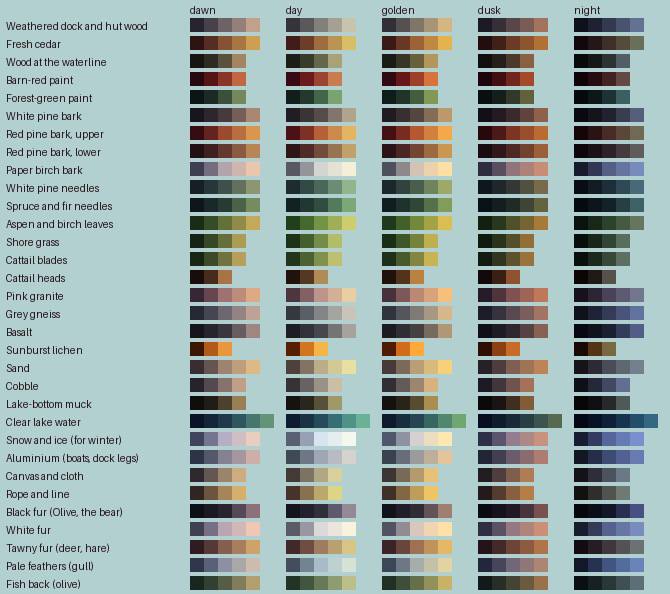
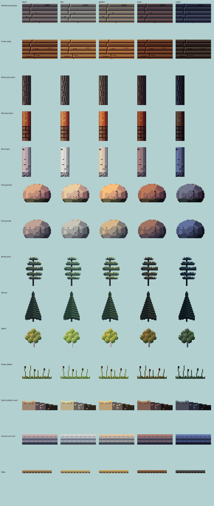
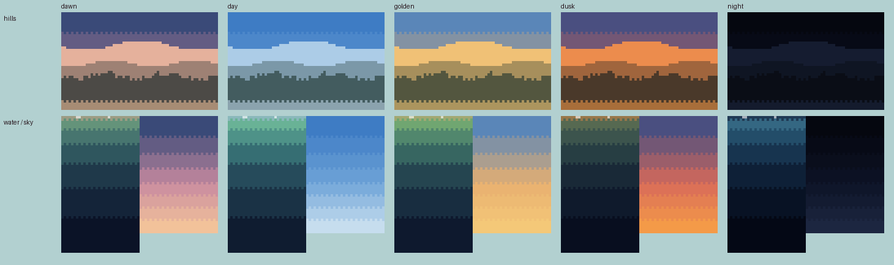

# The materials library

Every material in the lake as a colour ramp, how it is lit at each time of day, and a texture sample drawn by its rules. Built by `tools/studio/materials.py`; the numbers are in [materials/materials.json](materials/materials.json).

## How it works

- **Ramps.** Each material starts from a real colour (from [the north-woods research](research/north-woods-lake.md)) as its middle shade. Each step darker turns its hue about 10° toward blue-violet, each step lighter toward yellow, with saturation highest in the middle. Metal goes the other way: cool pale lights, warm deep darks.
- **Light by time of day.** Each time (dawn, day, golden hour, dusk, night) has a key light (sun or moon) and an ambient colour (the sky). The light end of every ramp takes the key light, the dark end the sky, so the light changes the colours rather than tinting them, and shadows stay cool. This is how decision 4 (a palette for each time of day) will work in the game.
- **Sky, hills and water** take their colours from the time itself: the sky in flat bands of varied height joined by one row of ordered dither; the hills in three bands of haze, each farther one lighter and nearer the sky, dark silhouettes at night; the clear lake darkening in bands from a surface that mirrors the horizon.
- **Texture samples** follow the research: planks with contrast at the seams and grain on only a few boards; bark by tree; granite chiselled into big clean planes with a few flecks and lichen; tiered needles with a dark crescent under each tier; leaf clusters lit as round shapes; a lakebed of sand, a few shaded cobbles and quiet muck. Clusters, not specks; no noise dither.

## The materials

| Material | Day ramp | Rule |
| --- | --- | --- |
| Weathered dock and hut wood | `#353439` `#5a585b` `#82807b` `#a4a194` `#c8c3ac` | Silver-grey cedar after a season or two. Planks: lit bevel on top, shadow under, the seam darkest; grain on only a few; a stained board now and then. |
| Fresh cedar | `#411c18` `#6e3d2a` `#9e6c3f` `#ba9452` `#d7bf67` | New boards and trim before they grey: warm red-tan, same plank rule. |
| Wood at the waterline | `#1d1d17` `#393b2a` `#66674a` `#a8a277` | Green-black where posts and planks stay wet. |
| Barn-red paint | `#370a14` `#6a1b1b` `#9c4432` `#ca7c50` | The hut's trim and door; flat paint, soft highlight. |
| Forest-green paint | `#111e1b` `#23392d` `#436549` `#79a470` | The other trim colour. |
| White pine bark | `#221d22` `#3a3436` `#554c4a` `#80766b` `#afa48e` | Grey-brown with a purple cast, long furrowed plates; stripes widest mid-trunk. |
| Red pine bark, upper | `#4b1115` `#7f3025` `#b6603a` `#cd8a4d` `#e4b561` | Thin, flaky orange-red bark high on the trunk; glows in evening sun. |
| Red pine bark, lower | `#2f1518` `#4f2b28` `#734b3a` `#987351` `#c0a169` | Thick grey-brown to reddish plates low on the trunk. |
| Paper birch bark | `#585862` `#94959b` `#d4d4d1` `#e4e2d5` `#f5efd8` | Chalk white with short black horizontal marks, a pink curl now and then. |
| White pine needles | `#1d2c2e` `#324945` `#4a675a` `#6c8d73` `#93b58b` | Soft blue-green in flat horizontal tiers with gaps; dark crescent under, light on top. |
| Spruce and fir needles | `#122121` `#203732` `#304d3f` `#527a5b` `#7aa876` | Darker, a sharp spire of short tiers, upper tiers shading the ones below. |
| Aspen and birch leaves | `#223f1b` `#44692f` `#739445` `#9eaf58` `#cdcc6e` | Round clusters; detail at the edges, calm inside; gold in fall. |
| Shore grass | `#1c3318` `#425f2d` `#748c49` `#b2bc69` | Short 1 px blades, thicker near, 1-2 px clusters far. |
| Cattail blades | `#22351a` `#4b6333` `#80914e` `#bec06f` | Long leaning blades; heads in the shared brown. |
| Cattail heads | `#22120c` `#553822` `#af8b55` | 2-3 px dark brown heads. |
| Pink granite | `#4d363f` `#836063` `#bd9489` `#d2b097` `#e9cda3` | Big clean planes chiselled from a blob, a few dark flecks, lichen on top, algae at the waterline. |
| Grey gneiss | `#35393f` `#5a5e65` `#828487` `#a4a4a0` `#c8c4b8` | The other shore rock; same rule. |
| Basalt | `#1c1e23` `#313338` `#46474c` `#747476` `#a6a29d` | Dark, weathering rusty. |
| Sunburst lichen | `#571e04` `#d3751f` `#f5b54b` | Small orange clusters on shore rock. |
| Sand | `#4d403d` `#827363` `#bcad89` `#d2c997` `#e8dfa3` | Wavy hard-edged ripples, a few 'c' marks, cool shadow to warm light. |
| Cobble | `#363337` `#686262` `#9a9187` `#cabfa6` | Rounded stones in grey, pink and black; only a few shaded. |
| Lake-bottom muck | `#161210` `#2b261d` `#58513a` `#9f9968` | Flat dark brown-black, a few soft lumps; the quietest texture. |
| Clear lake water | `#0f1c30` `#1a3245` `#264b5b` `#366e73` `#4e9288` `#69b296` | Green-teal shallows to dark teal: flat bands of varied height, ordered dither only at the joins. |
| Snow and ice (for winter) | `#596071` `#95a0b2` `#d8e4f1` `#e5eeee` `#f4f8ec` | White through cyan to deep blue; zig-zag snow on top surfaces. |
| Aluminium (boats, dock legs) | `#404a54` `#6d7785` `#9ea7b3` `#b8bcc2` `#d6d3cf` | Metal: cool pale lights, warm deep darks, lines of reflection, rivets. |
| Canvas and cloth | `#413a36` `#7d7363` `#b0a785` `#d7d09e` | Soft shadows, no highlight; folds from pinch points. |
| Rope and line | `#46342a` `#87714e` `#bba86d` `#ded485` | A regular diagonal step, light and dark every 2 px. |
| Black fur (Olive, the bear) | `#14141c` `#21222d` `#30303d` `#5e5a6b` `#948896` | Clumps, not strands; inner lines in darker fur, never black. |
| White fur | `#5a5b66` `#9998a2` `#dcd9db` `#eae5dd` `#f9f2dd` | Same rule; shade cools toward blue-grey. |
| Tawny fur (deer, hare) | `#412829` `#6f4d43` `#9f7b5f` `#ba9f71` `#d8c485` | Same rule. |
| Pale feathers (gull) | `#444d5e` `#738394` `#a7bcc7` `#bdd1d0` `#d4e3d6` | Rows as single clusters overlapping toward the body, split by one shadow line. |
| Fish back (olive) | `#233426` `#41563f` `#667a58` `#8e9c71` `#bcbf8a` | Scales by suggestion: a few arcs in the mid tones, ends plain. |

## What the samples already tell us

- **Planks, bark, granite, aspen, lakebed, aluminium and rope** read well at every time of day and are close to ready.
- **White pine** reads as tiers but is still too tidy; the real tree is ragged, flat-topped and flagged by the wind. **Spruce** still shows stripes (each tier the same thickness); it needs uneven tiers. Both are the subject of a study.
- **The time-of-day light** keeps materials distinct even at night (the birch stays pale blue-white, the granite grey-violet), which a single tint over everything cannot do.
- **Snow** in golden light goes very yellow; worth checking against reference before winter.

Nothing here is in the game yet. Each material goes in once a study settles it.
